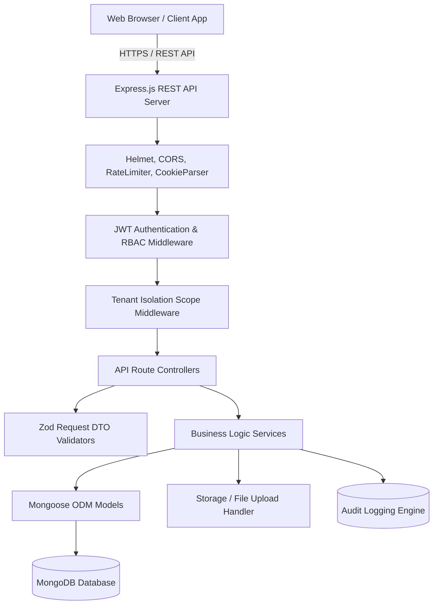

# ALYSTRO Architecture Specification

## 1. High-Level Architecture Overview
ALYSTRO adopts a decoupled client-server monorepo architecture, ensuring clean separation of concerns, strict multi-tenant isolation, enterprise-level security, and seamless developer experience.



## 2. Directory Structure
```
/alystro
  /client                 # React 18 + Vite + TypeScript frontend
    /src
      /assets             # Logos, brand badges, illustration assets
      /components         # Core reusable UI atoms, molecules, organisms
        /ui               # Buttons, Modals, Inputs, Cards, Badges, Tables
        /layout           # Public Navbar, Footer, Dashboard Sidebar & Header
      /pages              # Public pages (Home, About, Programs, etc.)
        /public           # Public pages & marketing routes
        /admin            # Super Admin & Staff dashboard pages
        /school           # School Admin dashboard pages
        /teacher          # Teacher / Mentor dashboard pages
        /student          # Student learning portal pages
      /features           # Feature-specific modules (CRM, LMS, CMS, Certs)
      /hooks              # Custom React hooks (useAuth, useTenant, etc.)
      /services           # Axios / Fetch API client & service endpoints
      /routes             # React Router v6 guarded route definitions
      /types              # Shared TypeScript definitions for frontend
      /utils              # Formatting, date helpers, export utilities
  /server                 # Node.js + Express + TypeScript backend
    /src
      /config             # Environment variables, DB connection, constants
      /controllers        # HTTP request & response handlers
      /services           # Business logic, aggregations, certificate generator
      /models             # Mongoose schemas with strict types and indexes
      /routes             # Express versioned REST route declarations (/api/v1)
      /middleware         # Auth, RBAC, tenant isolation, error handling, rate limits
      /validators         # Zod schemas for input validation
      /utils              # JWT token generator, password hashing, logger, QR generator
      /seed               # Database seeder with realistic initial demo data
  /shared                 # Shared TypeScript interfaces, types, and constants
  /docs                   # Comprehensive project documentation
  .env.example            # Environment configuration template
  README.md               # Setup and development guide
```

## 3. Communication & API Contract
- Base API Endpoint: `/api/v1/`
- Standard Response Envelope:
```json
{
  "success": true,
  "message": "Operation completed successfully",
  "data": { ... },
  "meta": {
    "page": 1,
    "limit": 20,
    "total": 140,
    "totalPages": 7
  }
}
```
- Error Response Envelope:
```json
{
  "success": false,
  "message": "Human-readable error description",
  "errors": [
    { "field": "email", "message": "Invalid email address" }
  ],
  "statusCode": 400
}
```

## 4. Multi-Tenant Scoping Strategy
1. The `School` collection represents organizational tenants.
2. Every school-scoped model (`Student`, `Teacher`, `Batch`, `Enrollment`, `Attendance`, `Assignment`, `Notice`, `Invoice`) maintains a mandatory `school: ObjectId` reference field indexed with compound indexes.
3. The `tenantScope` middleware extracts the active tenant context:
   - For `SUPER_ADMIN` and `ADMIN`, `schoolId` can be passed as a query filter or left unrestricted to view global metrics.
   - For `SCHOOL_ADMIN`, `TEACHER`, and `STUDENT`, `schoolId` is strictly injected from the verified JWT payload:
     `req.schoolId = req.user.schoolId;`
   - Any query attempting to override or access records with an alternate `schoolId` will be rejected with HTTP 403 Forbidden.

## 5. Security Architecture
- **Authentication**: JWT tokens signed with SHA-256 (`HS256`), transmitted either via secure HTTP-Only Cookies or Authorization Bearer header.
- **Password Protection**: Passwords salted and hashed with `bcryptjs` (salt rounds: 12).
- **Rate Limiting**: `express-rate-limit` prevents brute-force attacks on `/api/v1/auth/*` and `/api/v1/leads/*`.
- **Helmet**: Secures HTTP response headers against clickjacking, MIME-sniffing, and XSS.
- **Input Validation**: Strict Zod schemas validate both body, params, and query parameters before reaching controllers.
- **Audit Logging**: All write operations on sensitive modules (school status, payments, role changes, certificate issuance) write to the `AuditLog` collection.
